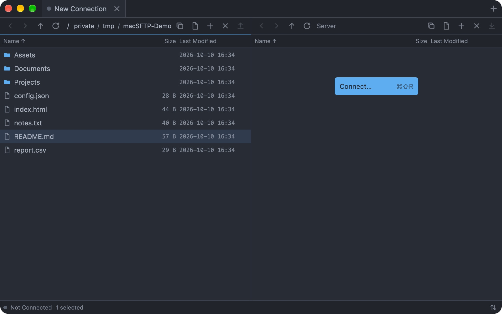
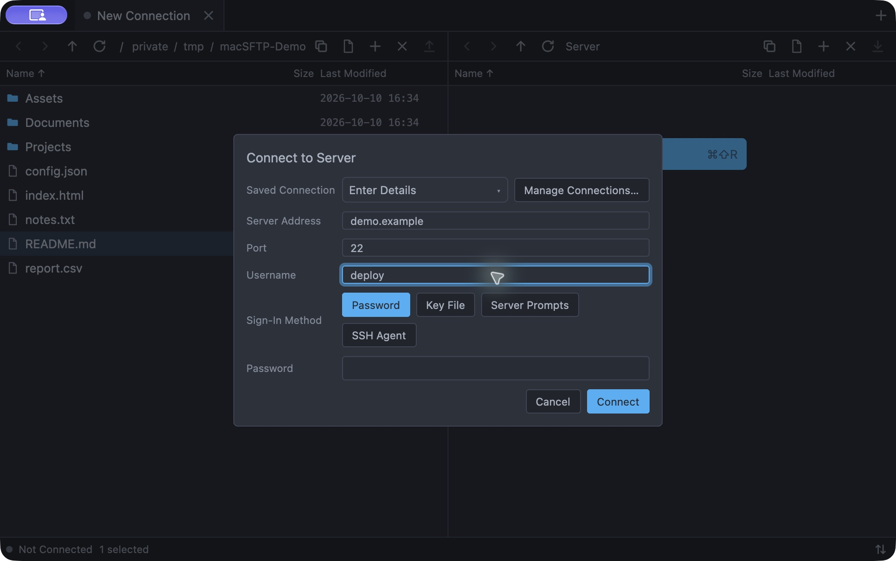
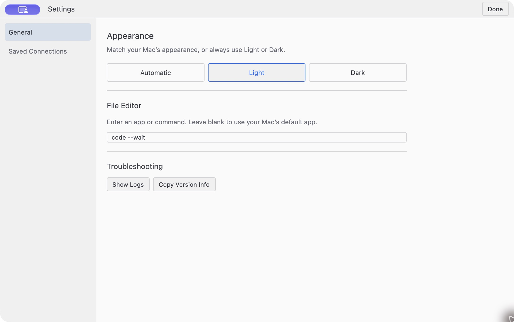

# macSFTP

[English](README.md) | [简体中文](README.zh-CN.md) | [日本語](README.ja.md) | **한국어**

Rust로 만든 네이티브 macOS SFTP 클라이언트입니다. macSFTP는 로컬 파일과 원격 파일을 한 창에 나란히 배치합니다. 위쪽에는 연결 탭, 가운데에는 두 개의 파일 창, 아래쪽에는 전송 드로어가 있습니다. UI는 GPUI와 GPUI Base로 그리고, SSH와 SFTP는 `russh`와 `russh-sftp`를 Tokio 위에서 실행합니다.

macSFTP는 아직 프리릴리스 단계입니다. 로컬 사용을 위한 서명되지 않은 앱 번들을 빌드할 수 있으며, 공개 릴리스는 소스만 제공합니다. Developer ID 서명, 공증, 자동 업데이트, SFTP 이외의 프로토콜은 현재 범위에 포함되지 않습니다.

## 스크린샷

**로컬 및 원격 창**



**저장된 프로필 또는 일회성 연결로 접속**



**라이트 테마와 외부 편집기 설정**



스크린샷은 로컬 예제 파일로 구성한 격리된 미리보기에서 촬영했습니다. 서버 창은 연결되지 않은 상태이며, `demo.example`과 `deploy`는 예제 연결 정보입니다.

## 기능

**연결과 보안**

- 여러 창, 각 창은 독립적인 연결 탭을 가집니다
- 저장된 프로필과, 프로필 목록에 들어가지 않는 일회성 연결
- 비밀번호, 여러 단계의 keyboard-interactive, SSH agent, 개인 키 인증
- Ed25519, ECDSA, RSA-SHA2 클라이언트 키. RSA 직접 서명은 AWS-LC 사용
- 저장된 프로필 기반 단일 홉 점프 호스트와 명시적 OpenSSH 형식 `ProxyCommand`
- OpenSSH 호환 호스트 키 검증(`known_hosts` 하위 집합)
- 알 수 없는 호스트는 사용자 확인을 요구하고, 저장된 키와 일치하지 않으면 연결을 차단
- 비밀번호와 개인 키 암호는 macOS Keychain에 보관하고 메모리에는 짧게 유지되는 사본만 둠

**파일 탐색**

- 로컬/원격 창, 뒤로·앞으로 기록, 경로 탐색, 경로로 이동
- 가상화된 파일 목록으로 1만 개 항목에서도 반응성 유지
- 필터, 정렬, 다중 선택, Finder 방식 타입 선택, 숨김 파일 표시
- 이름 변경, 새 폴더, 삭제, 경로 복사. 로컬 파일은 Finder에서 보기 지원
- 파일 목록과 입력 필드의 컨텍스트 메뉴는 네이티브 AppKit 메뉴로 표시

**전송**

- 디렉터리 업로드/다운로드를 플랜으로 모델링하고 진행 상황을 스트리밍
- 파이프라인 다운로드: 동시 요청 16개, 256 KiB 청크, 플랜당 최대 4개 작업, 전체 최대 6개
- 충돌 처리, 플랜 단위 "모두 적용", 취소, 재시도
- 프로세스 전역 전송 드로어를 모든 창이 공유
- 메타데이터 보존 실패는 경고로 표시하고 전송된 데이터는 성공 상태로 유지
- 심볼릭 링크는 링크 자체를 복사하고 기본적으로 대상을 따라가지 않음

**원격 편집**

- 원격 파일을 열면(두 번 클릭, `↩`, 컨텍스트 메뉴) 임시 복사본을 편집기로 엽니다
- 변경한 복사본에는 `●`가 표시되며, 업로드는 명시적 동작에서만 시작됩니다
- **Upload Changes**를 명시적으로 실행하며, 업로드 전에 실시간 원격 메타데이터를 확인
- 원격 파일이 변경되었으면 충돌 결정을 요구하고 **Compare Changes…**를 제공
- 글롭/확장자별 편집기 규칙과 상태 표시줄의 편집 상태 표시

**인터페이스**

- One Light와 One Dark 테마, 시스템 설정을 따르거나 고정 가능
- 앱 수준 동작은 명령 팔레트에서 실행하며, 창과 앱 수명 주기 명령은 표준 메뉴 위치에 남습니다
- 파일 목록, 모달, 탭, 설정을 키보드로 조작
- 전송 진행, 오류, 빈 상태에서 다음에 할 일을 명시

## 서버에 연결

`⌘T`로 연결 탭을 추가한 뒤 서버 창에서 **Connect…**를 선택해 서버, 포트, 사용자 이름, 로그인 방법을 입력합니다. **Enter Details**를 선택하면 연결은 일회성으로 유지됩니다. 저장된 프로필이 되지 않고 자격 증명도 저장되지 않지만, 해당 엔드포인트는 Recent Connections에 표시됩니다. 프로필로 저장하려면 저장된 프로필을 선택하거나 **Manage Connections…**를 여세요. 프로필은 **Settings → Saved Connections**에서 만들고 편집합니다.

연결에 성공하면 서버 창의 **Recent Connections** 목록에 최대 6개까지 기록됩니다. 표시 이름, `user@host:port`, 마지막 원격 폴더가 함께 표시됩니다. 저장된 프로필에 사용할 수 있는 자격 증명이 남아 있으면 선택 즉시 재연결하고, 그렇지 않으면 입력이 채워진 연결 폼이 열립니다.

알 수 없는 호스트에 처음 연결하면 서버 주소, 키 종류, SHA-256 지문, 저장될 `known_hosts` 위치를 보여 줍니다. 기본 동작인 **Trust and Save**는 명시적인 결정입니다. 저장된 키와 일치하지 않으면 연결이 차단됩니다.

## 키보드 단축키

| 단축키 | 동작 |
| --- | --- |
| `⌘N` / `⌘⇧W` | 새 창 / 창 닫기 |
| `⌘T` / `⌘W` | 새 연결 탭 / 탭 닫기 |
| `⌘⇧]` / `⌘⇧[` | 다음 / 이전 탭 |
| `⌃Tab` | 탭 전환기, 최근 사용 순 |
| `⌘1` / `⌘2` | 로컬 / 서버 창에 포커스 |
| `⌘↑` | 상위 디렉터리로 이동 |
| `⌘[` / `⌘]` | 뒤로 / 앞으로 |
| `⌘⇧G` | 폴더로 이동 |
| `⌘F` | 파일 필터 |
| `⌘⇧.` | 숨김 파일 표시 |
| `↩` / `F2` | 열기 / 이름 변경 |
| `⌘⇧N` / `⌘⌫` | 새 폴더 / 삭제 |
| `⌘⇧C` | 경로 복사 |
| `⌘U` / `⌘D` | 선택 항목 업로드 / 다운로드 |
| `⌘⇧U` | 편집한 파일 업로드 |
| `⌘J` | 전송 드로어 표시 |
| `⌘R` / `⌘⇧R` | 새로 고침 / 다시 연결 |
| `⌘⇧P` | 명령 팔레트 |
| `⌘,` | 설정 |

대부분의 명령은 메뉴 막대 항목도 있으며, 명령 팔레트(`⌘⇧P`)에서 현재 창의 앱 수준 동작을 검색할 수 있습니다.

## 원격 편집 흐름

원격 편집은 명시적으로 동작합니다. 편집기에서 저장해도 업로드가 시작되지 않습니다.

1. 원격 파일을 엽니다(두 번 클릭, `↩`, 컨텍스트 메뉴). macSFTP가 임시 복사본을 내려받아 편집기로 엽니다.
2. 복사본을 편집하고 저장합니다. 임시 복사본이 바뀌면 목록에 `●`가 표시됩니다.
3. 원격 파일을 다시 선택하고 상태 표시줄의 **Upload Changes** 또는 **Upload Edited File**(`⌘⇧U`)을 실행합니다.
4. macSFTP가 실시간 원격 메타데이터를 읽습니다. 서버 파일이 바뀌었으면 덮어쓰기 전에 확인하고 **Compare Changes…**를 제공합니다.
5. 실패하면 로컬 복사본을 유지하며 다시 시도할 수 있습니다.

**Compare Changes…**는 매번 원격 파일을 별도 디렉터리로 새로 내려받으므로, 오래된 스냅샷이 현재 서버 버전으로 취급되지 않습니다. 탭이나 창을 닫으면 편집 세션이 끝나고 임시 디렉터리가 제거됩니다.

## 요구 사항

- macOS 13 이상. 검증된 아키텍처는 arm64이며, 툴체인이 해당 타깃을 고정하고 릴리스 기록도 이를 다룹니다
- Xcode
- Rust `1.96.1`(`rust-toolchain.toml`에 고정), `rustfmt`와 `clippy`
- 아키텍처 검사용 Python `3.11` 이상(CI는 `3.13`)
- 실제 세션 테스트용 `/usr/sbin/sshd`, `ssh-keygen`, `ssh-keyscan`

Metal 셰이더는 앱 시작 시 컴파일되므로 macSFTP 빌드에 별도의 Metal Toolchain 구성 요소가 필요하지 않습니다.

## 빌드와 실행

```bash
cargo run                 # 워크스페이스에서 바로 실행
bash scripts/check.sh     # fmt, 아키텍처, 로그 안전성, 테스트, clippy
bash scripts/build_app.sh # build/macSFTP.app에 서명되지 않은 번들 생성
```

`open build/macSFTP.app`으로 앱을 열 수 있습니다. 서명이 없어 로컬 테스트용이며, 배포에는 Developer ID 서명과 공증이 필요합니다.

`check.sh`는 CI와 동일한 포맷, 아키텍처, 로그 안전성, 테스트, Clippy 게이트를 실행합니다. SFTP 통합 테스트는 로컬 `sshd`에 연결합니다. 로컬에서 사용할 수 없으면 명확한 메시지와 함께 건너뛰지만, CI는 `MACSFTP_REQUIRE_SSHD=1`을 설정하므로 건너뛰지 않고 실패합니다. `Cargo.toml`, `Cargo.lock` 또는 벤더 코드를 변경할 때는 다음도 실행하세요.

```bash
cargo deny --locked check advisories bans licenses sources
```

## 데이터 저장 위치

| 경로 | 내용 |
| --- | --- |
| `~/Library/Application Support/macSFTP/config.json` | 환경 설정 |
| `~/Library/Application Support/macSFTP/profiles.json` | 저장된 연결 프로필, 민감 값 없음 |
| `~/Library/Application Support/macSFTP/known_hosts` | 신뢰한 호스트 키 |
| `~/Library/Application Support/macSFTP/session.json` | 창과 탭 복원 정보 |
| `~/Library/Application Support/macSFTP/recents.json` | 최근 연결 대상 |
| `~/Library/Application Support/macSFTP/edits/` | 원격 편집용 임시 복사본 |
| `~/Library/Application Support/macSFTP/residual_temp.json` | 중단된 전송이 남긴 임시 파일 기록 |
| `~/Library/Logs/macSFTP/macsftp.log` | 진단 로그 |

비밀번호와 개인 키 암호는 macOS Keychain에 저장되며, 프로필은 참조만 보관합니다. 명령 팔레트의 **Show Logs**로 로그 폴더를 열 수 있습니다. 로그는 비밀 값, 개인 키 전체 경로, ProxyCommand 내용을 가린 뒤 기록됩니다.

## 아키텍처

워크스페이스는 책임에 따라 나뉩니다.

| Crate | 책임 |
| --- | --- |
| `macsftp-core` | 순수 모델과 상태 머신 |
| `macsftp-ui` | 프로젝트 스타일의 GPUI Base 컨트롤, 테마, 표현 계층 |
| `macsftp-native-menu` | 입력 필드와 파일 창 컨텍스트 메뉴를 위한 격리된 macOS AppKit 표시 계층 |
| `macsftp-app` | 창, 액션, UI 상태, 이벤트 조정 |
| `macsftp-sftp` | Tokio runtime, russh 어댑터, 세션, 전송 |
| `macsftp-storage` | 프로필, known hosts, Keychain 참조, 마이그레이션 |
| `macsftp-platform` | macOS와 로컬 파일 시스템 경계 |
| `macsftp-test-support` | 공유 통합 테스트 픽스처 |

GPUI와 Tokio는 유계 command/event 채널로 통신하며, 네트워크 작업은 UI 스레드 밖에서 실행됩니다. 닫힌 탭이나 대체된 세션에서 온 오래된 이벤트는 상태를 변경하기 전에 `core`에서 거부됩니다. 의존성 규칙, 런타임 모델, UI 제약은 [`docs/architecture.md`](docs/architecture.md)에 문서화되어 있습니다.

프로덕션 SFTP runtime은 실제 SSH 백엔드를 대상으로 빌드되며, 모의 actor와 생성자는 크레이트 테스트용으로만 컴파일됩니다.

## 범위 밖

FTP, WebDAV, S3, 내장 터미널, 디렉터리 동기화, 다중 홉 점프 호스트 체인, `~/.ssh/config` 전체 파싱, 실행 간 전송 복원, App Store 배포, 공증된 릴리스, 종료 후에도 계속되는 백그라운드 전송.

## 보안

자격 증명, 개인 키 내용, 호스트 지문 및 기타 민감한 데이터는 공개 이슈 밖에 두세요. 비공개 신고 절차는 [`SECURITY.md`](SECURITY.md)를 참고하세요.

## 기여

runtime, SFTP, 전송, 호스트 키, 영속화 또는 UI 동작을 변경하기 전에 [`AGENTS.md`](AGENTS.md)와 [`CONTRIBUTING.md`](CONTRIBUTING.md)를 읽어 주세요. Pull request는 작고 집중적으로 유지하고 검증 방법을 설명하며, 눈에 보이는 UI 변경에는 시각적 증거를 첨부하세요.

## 라이선스

macSFTP는 [MIT License](LICENSE)로 제공됩니다. 네이티브 메뉴 어댑터는 [Apache-2.0 License](crates/native-menu/LICENSE-APACHE)를 사용하며, 각색한 AppKit 구현의 저작자 표시를 유지합니다.
